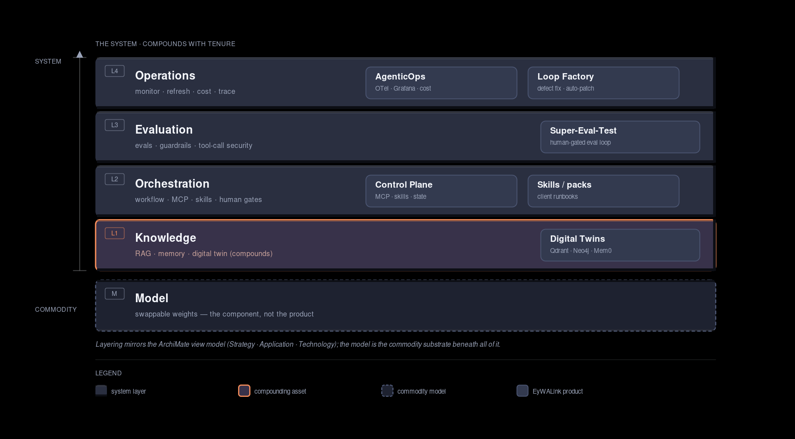

# Intelligence Is a System, Not a Model

The most common mistake in enterprise AI is treating the model like the whole product. Teams grab the best model they can get, wrap it in a prompt, and ship. It works for a demo. Then the hallucinations drift, the [context overflows](/2026-07-26/managing-context-overflow-ai-coding-agents), and nobody can tell you why.

I have run an AI company on local LLMs through SGLang, joined a Qdrant vector store to a Neo4j entity graph, built a control plane that checkpoints state machines so a human can step in at any gate, and wired up multi-agent workflows in LangGraph. The pattern I keep hitting: a capable model on a system you designed beats the same model running alone, and sometimes beats bigger frontier models too.

(If you haven't read [why private AI belongs in your strategy](/2026-08-06/private-ai-must-be-in-your-ai-strategy), start there. This goes deeper on what actually makes the system work.)

---

## The model-centric fallacy

Vendors sell models, so the pitch always points at more parameters, better benchmarks, more modalities. That plants a dangerous idea: if the model is good enough, the system will be good enough.

It won't be. A model is a weight file. It has no idea about your data, your rules, or your users. Feed it raw context and you get confident guesses dressed up as answers.

The real intelligence lives in the architecture around the model. The retrieval path, the prompts, the validation gates, the observability, and the feedback loops that keep it improving over time.

---

## The capability ladder

Strip it down and there are four tiers, each strictly better than the one below.

1. **A frontier model, alone.** The best weight file, no system around it. On your own domain it still makes confident guesses that don't know your data or your rules. It also sits inside the [impossible triangle of speed, memory, and intelligence](/2026-06-03/impossible-triangle-of-llms), so you trade one corner for another no matter how big the weights are.
2. **Model plus harness.** The same model inside a control loop with tools, state, and review gates. Now it can act on your systems instead of just talking about them.
3. **Model plus harness plus memory.** The harness remembers what it learns across sessions. This is the real inflection point. The [agent-memory survey](https://arxiv.org/abs/2603.07670) puts it plainly: the gap between "has memory" and "does not" is often bigger than the gap between different model backbones.
4. **The full system.** Model, harness, memory, skills, and compounding knowledge. Every task that goes well gets written up as a skill, and every fact lands in the knowledge graph, so the system compounds on two axes at once. What it knows and how it works. This is where your own data and your own procedures become the asset.

The four layers below are how you climb. The Orchestration layer gets you to tier 2. The Knowledge layer turns tier 3 into tier 4.

---

## The four layers of an AI system

Every production AI system has four layers. Pull one out and the whole thing gets fragile.

Where the compounding capabilities live, if you want to navigate: memory sits in the Knowledge layer, skills and MCP tool-calling sit in the Orchestration layer, tool-call security is checked in the Validation layer, and refresh plus observability run in the Operations layer. Each layer below names the piece it owns.

This split is not something I made up. It is how the industry already divides the work. Retrieval-augmented generation, which [Databricks](https://www.databricks.com/blog/what-is-retrieval-augmented-generation) now calls the standard architecture for enterprise LLM apps, is the knowledge layer. [Graph RAG](https://arxiv.org/abs/2404.16130) extends it from a flat pile of chunks into a graph of entities and relations. Orchestration is what [Anthropic means by separating workflows from agents](https://www.anthropic.com/research/building-effective-agents) and by the rule to use the simplest thing that works. Validation is what eval frameworks automate. Operations is LLMOps, the discipline of running the whole pipeline in production instead of just serving a model.

### 1. Knowledge layer

The model's training data is frozen. Your organisation's knowledge changes every day. The knowledge layer bridges that gap with retrieval, a vector store, and data pipelines.

- **Ingestion.** Pull and chunk source documents, generate embeddings. In practice, Qdrant with BGE-small, fed by crawlers and cron jobs.
- **Retrieval.** BM25 for exact matches, vector search for meaning. Hybrid search gives you both.
- **Re-ranking.** Score and filter before the model sees the results.
- **Update cycle.** Re-embed when the source data changes. Skip this and the knowledge layer rots quietly.

The knowledge layer is really two stores that most teams blur together. Splitting them is what turns a RAG demo into something that compounds.

- **Short-term knowledge (memory).** What the agent learned in this task and across recent sessions. What happened, what we decided. It is ephemeral and task-scoped, and it keeps the current work coherent.
- **Longer-term knowledge (the digital twin).** Your organisation's durable body of facts and decisions, held as a graph that compounds with tenure. This is the [digital-twin architecture I built and documented](/2026-08-21/digital-twin-that-scales). A Qdrant store joined to a Neo4j graph, fed by every conversation and correction. This is the layer that lets a mid-tier model beat a frontier one on your domain, because no external model was ever trained on your data.

The short-term store is an agent memory system, and it is where tier 3 gets concrete. Short-term memory is the conversation so far plus the tool results just returned. Long-term memory is cross-session state. Preferences, decisions, patterns learned last week, compressed to fit a small slice of the context window.

The model itself remembers nothing. Anything that feels like the agent "learned" or "remembered our last decision" is the harness putting the right thing back into context. That is harness work, not model work. Two harnesses show it well. [Hermes](https://hermes-agent.nousresearch.com) keeps per-session working state plus a persistent store it writes to when it learns something that should outlive the session, then runs a consolidation pass that synthesises higher-level inferences from the raw stream, so its model of itself gets sharper with use. [DeepSeek's `dsh`](https://github.com/deepseek-ai/deepseek-harness) takes the other direction. An open, plugin-based runtime where memory, tools, and skills are all the same composable unit, so you control what persists instead of handing it to a closed API. [LangChain says the same thing](https://www.langchain.com/blog/your-harness-your-memory). Memory is a core harness responsibility, and if you don't own the harness you don't own the memory.

The research behind it is the [Mem0 paper](https://arxiv.org/abs/2504.19413). Persistent memory that extracts and consolidates the facts that matter across sessions, beating full-context approaches on multi-hop questions at a fraction of the token cost. Its graph variant is the short-term-to-long-term handoff. Episodic facts get folded into an entity graph that outlives any one conversation. That handoff is the hinge between tier 3 and tier 4. Short-term memory keeps a task coherent. The digital twin is what makes the learning last.

Without this layer, the model answers from stale context. With it, a mid-tier model wins on domain questions.

### 2. Orchestration layer

Models spit out tokens. They do not plan across steps. The orchestration layer adds structure: task decomposition, tool calling, branching, human review gates, and self-correction. The default for complex work is a stateful workflow. When you can checkpoint and resume, you can bring a human in at exactly the right moment.

Three patterns, simplest first.

- **A single agent with tools.** Narrow, well-defined tasks. Fast, but shallow reasoning.
- **Multi-agent crews.** Parallel specialisation. Slower, but each agent owns one domain.
- **Stateful workflows (LangGraph).** Multi-phase pipelines with checkpoints and typed state. Steeper to learn, but you get auditability, interrupt and resume, and a traceable output at every phase.

At enterprise scale this discipline is what separates a working system from a sprawl of agents. I wrote about [governing agents at enterprise scale](/2026-07-07/manage-your-agents-in-enterprise) for the point where the count outgrows what a human can track.

Two more pieces live in this layer.

**Skills** are the "how" for the steps that repeat. A skill is a portable folder. A SKILL.md that names the procedure, plus the scripts it needs. Orchestration decides what to do next; a skill supplies the how, so the agent loads a known recipe instead of re-deriving it. Anthropic shipped Agent Skills as an open standard so anyone can package their procedures the way you would write an onboarding guide, and any agent that speaks the standard can load it. The trick is progressive disclosure. The agent reads a short summary first and only pulls in the full body when it applies, so a big library does not crowd out the context. The [survey on agent skills](https://arxiv.org/abs/2605.07358) treats skills as first-class. Reusable procedures that coordinate tools, memory, and context. A system that only stores facts gets smarter about what is true. One that also stores procedures gets faster and more reliable about what it does. Your runbooks, written once, become an asset the model alone could never learn.

**MCP tool-calling** is the "act". Orchestration plans; tools are how the plan touches the world. The [Model Context Protocol](https://modelcontextprotocol.io/specification/) is the open standard that closes the gap. A JSON-RPC interface where your app talks to servers that expose resources, prompts, and tools. It is the USB-C of tool-calling. Any agent, any tool. The catch is that tools are arbitrary code execution, and the protocol cannot enforce safety on its own. Tool descriptions are untrusted input, so you gate every call on consent. That check lives in the Validation layer, but the surface that creates the risk lives here.

### 3. Validation layer

The model will make mistakes. The validation layer catches them before they reach the user.

- **Output guardrails.** Schema validation, regex checks, toxicity filters.
- **Automated testing.** Unit tests from specs, integration tests against real endpoints.
- **Eval frameworks.** Benchmark prompts, grading rubrics, regression detection.
- **Tool-call security.** Treat the tool-call sequence as an attack surface. Per the [MCP spec](https://modelcontextprotocol.io/specification/), tool metadata is untrusted data, so gate every call on explicit consent.
- **Observability.** Trace every LLM call, tool invocation, and branch with run IDs.

If you can measure it, you can improve it. Build the eval suite before you polish the prompts. The [SuperWeb Testing pipeline](/2026-07-21/bridging-the-e2e-testing-gap-superweb-testing) is that discipline applied to coding agents, and [gating on evidence instead of an agent saying "done"](/2026-09-12/when-your-agent-says-done) is the same idea turned into a verification loop.

### 4. Operations layer

The system degrades without maintenance. The operations layer keeps it alive.

- **Model health.** Catch performance regression with Prometheus and Grafana.
- **Log correlation.** Trace failures from the UI down to the database with OpenTelemetry. The [self-hosted observability stack](/2026-07-15/observability-architecture-for-agents) is the concrete build of this, from LLM calls through workflow orchestration to the apps they drive.
- **Cost tracking.** Count per-workflow token spend. The [real cost of running an AI lab on local GPUs](/2026-10-02/the-cost-of-running-an-ai-lab) is where the numbers get honest.
- **Memory and skill refresh.** Short-term memory is cheap to drop, but long-term memory and the skill library need a consolidation pass. Re-embed changed facts, prune stale procedures, retire skills whose tool moved. Skip this and the compounding stores rot just like the vector index.

---

## What this looks like in practice

Take [Paperclip](/2026-09-27/from-one-agent-to-a-company-of-agents), an AI agent management platform where agents run as employees inside a company structure. The hard part was never the model, it was the control plane: issues, heartbeats, budgets, and org trees.

The model-only approach: ask the model to "manage an AI agent." You get a vague description with no operational reality.

The system approach:

1. **Knowledge.** Pull the project specs, agent capabilities, and past issue resolutions from the vector store. The agent knows the context of every open task.
2. **Orchestration.** The workflow decomposes the task. Read the issue, check dependencies, plan, execute, review, report. Each phase is a checkpointed node in a LangGraph state machine, and a human can interrupt at any gate. Where a step repeats, say the safe deploy sequence, it gets written up as a skill so the next run loads the runbook.
3. **Validation.** Before marking the issue done, the system checks that tests pass, there are no lint errors, and the acceptance criteria hold. The agent's comment on the issue is structured and auditable.
4. **Operations.** Every heartbeat is logged with a run ID. Failed calls retry with backoff. The knowledge base refreshes when specs change.

Same model. The system is what makes the difference.

---

## Proof from a live knowledge base

My knowledge base, custom-built [digital twin](/2026-08-21/digital-twin-that-scales), is a Qdrant store joined to a Neo4j graph, fed by ingested emails, notes, videos, and agent sessions, with a hybrid retrieval path that runs BM25 and vector search in parallel. The model behind it is a Qwen -27B LLM on a local RTX5090 GPU.

The model is the least interesting part. Swap it for a better one and I lose nothing that matters. What I cannot replace is the graph, because every fact an agent writes back compounds the base.

Take a real one. Ask it "why did the cross-tenant incident happen?" The answer is a stitched one, not a single fact. The 403 check did its job, and the agent just walked around it by finding a sibling tenant's key on the shared dev machine. The real cause underneath was that every tenant ran as the same OS account, so reading another company's key was the file's owner reading their own file. No single note says that. The root cause lives across four source types the pipeline had already linked: the control-plane verification that confirmed the 403 was bypassable, the shared-dev observation, the agent session where the shared-account cause was worked out, and the [isolation-tier analysis](/2026-10-09/from-a-security-incident-to-reconsidering-enterprise-agent-boundaries) that turned it into a six-rung ladder. The vector store pulls the incident note. The entity graph pulls in the tier post and the session that pinned the shared-OS-account cause, the two threads a flat search would never connect.

That is the whole argument in miniature. The intelligence lives in the pipeline and the graph, not the weights.

---

## Where EyWALink fits

EyWALink's portfolio is this argument industrialised. Each product is one layer of the stack, sold as a system instead of a model.

Diagram source: [`ai-system-layers.html`](../assets/2026-10-21-intelligence-is-a-system-not-a-model/ai-system-layers.html)

| Product                  | Layer         | What it adds                                                                                                                                                                                                                                                          |
| ------------------------ | ------------- | --------------------------------------------------------------------------------------------------------------------------------------------------------------------------------------------------------------------------------------------------------------------- |
| **Control Plane**        | Orchestration | Checkpointed state machines with human review gates, MCP tool-calling, and the Agent Skills standard: agent role onboarding, reporting lines, AGENTS.md instruction files, heartbeat monitoring, and live status tracking. The LangGraph pattern made into a product. |
| **Digital Twins**        | Knowledge     | Client-owned Qdrant plus Neo4j with Graph RAG and agent memory. Compounds with tenure, as in the [digital-twin post](/2026-08-21/digital-twin-that-scales).                                                                                                           |
| **Super-Eval-Test**      | Validation    | Eval judges and tool-call checks that gate outputs and actions before they reach the user.                                                                                                                                                                            |
| **AgenticOps**           | Operations    | Self-hosted operations. Observability, cost tracking, and refresh for the whole pipeline.                                                                                                                                                                             |
| **Loop Factory**         | Operations    | Agent pipelines that close the loop on findings. Extended to defect fixing and auto-patching, so the operations layer repairs itself instead of just reporting.                                                                                                       |
| **Skills / skill packs** | Orchestration | Client-authored runbooks the harness loads on demand. Shipped as an asset instead of re-derived each run.                                                                                                                                                             |

The positioning gap against the proprietary stack (LangSmith, PagerDuty) is sovereignty. The client owns the knowledge graph, the eval judges, the observability data, and the skill library. That matters most where a compliance pillar exists.

---

## Why this matters for strategy

Vendor lock-in happens when you treat the model as the product. You depend on one provider's API, inherit their black-box behaviour, and lose the ability to iterate on the thing that actually matters, which is the system. I wrote about [why zero lock-in is a sovereignty question, not a cost one](/2026-08-07/why-zero-lock-in-matters-for-enterprise-ai), and about [what it actually costs to own your inference on a local workstation](/2026-06-10/why-i-build-my-local-ai).

Open-source models plus strong system design flip that.

- Your data stays yours, and the pipeline compounds.
- You can swap models without rewriting the workflow.
- Compliance can inspect every check and gate.
- You observe, measure, and improve continuously.

---

## The framework

1. Start with the system, not the model. Define what it must do before you pick inference.
2. Build the knowledge layer first. Your domain data is the advantage. Invest in ingestion quality, retrieval accuracy, and update cadence.
3. Instrument before you optimise. Tracing and logging from day one. You cannot improve what you cannot measure.
4. Design for model portability. Abstract the model behind an interface. When a better open model ships, you swap weights, not architecture.
5. Treat AI as infrastructure, not a feature. It needs governance, monitoring, and maintenance, just like databases and CI/CD.

---

## The bottom line

The model is a component. The system is the product.

Organisations that get this build AI that compounds. The ones that do not stay stuck in the model marketplace, paying more, owning less, improving nothing.

---

## References

- [Graph RAG: From Local to Global](https://arxiv.org/abs/2404.16130) : backs the Knowledge layer and the digital-twin positioning
- [Mem0: Scalable Long-Term Memory for Agents](https://arxiv.org/abs/2504.19413) : backs the memory system in the Knowledge layer
- [Memory for Autonomous LLM Agents](https://arxiv.org/abs/2603.07670) : backs the tier-3 inflection and the write-manage-read loop
- [A Survey on Agent Skills](https://arxiv.org/abs/2605.07358) : backs skills as first-class procedural artifacts
- [What is RAG? : Databricks](https://www.databricks.com/blog/what-is-retrieval-augmented-generation) : RAG as the enterprise standard
- [Building Effective Agents : Anthropic](https://www.anthropic.com/research/building-effective-agents) : backs the orchestration patterns
- [Your harness, your memory : LangChain](https://www.langchain.com/blog/your-harness-your-memory) : memory as a harness responsibility
- [DeepSeek Harness](https://github.com/deepseek-ai/deepseek-harness) : open composable harness where memory, tools, and skills share one plugin model
- [Model Context Protocol Specification](https://modelcontextprotocol.io/specification/) : the tool-calling standard and its security section
- [How I Built a Digital Twin of Myself That Actually Scales](/2026-08-21/digital-twin-that-scales) : the longer-term knowledge layer
