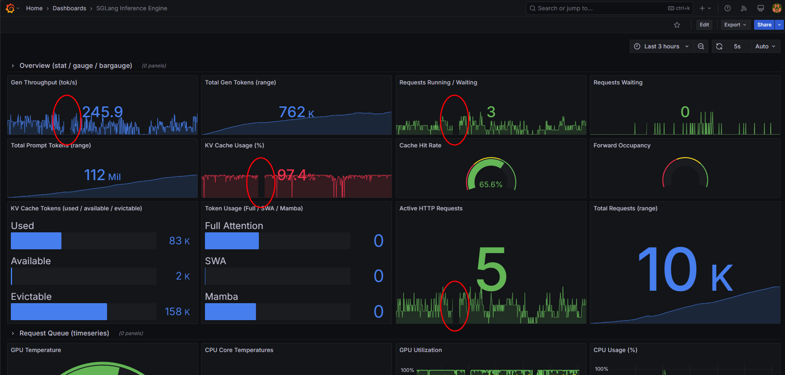
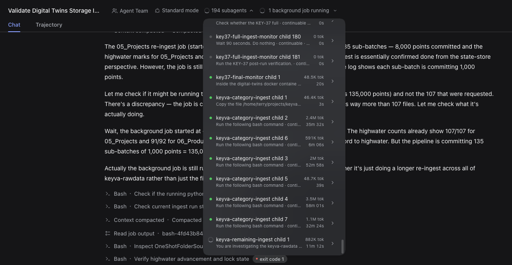

Capacity planning has long stood on predictable workloads: load-test, size to the measured peak, hold headroom, autoscale past a threshold. The operator knows the load in advance. Agentic systems break that assumption. An agent harness that spawns 194 sub-agents invents the load mid-flight; the peak is a property of the sub-agent army, not of my config. Both leading LLM-agent surveys treat that fan-out as emergent behaviour, not a tunable knob ([Rise of LLM-based agents](https://arxiv.org/abs/2309.07864), [LLM autonomous agents](https://arxiv.org/abs/2308.11432)), and with no peak to size to in advance, the traditional toolbox no longer fits.

This incident is the clearest case. On our lab box, at 08:31:46 the kernel's OOM killer fired globally, not inside a cgroup. It took out all agent workers, the observability stack, and the EyWALink mission control planes. Load spiked to ~685 on eight cores; by the time I looked, both services had auto-restarted and the load was decaying (685 → 581 → 202). It was the second memory event in twelve hours.

## What actually happened

The trigger was a research agent had kicked off to ingest a 11 GB imported folder into the digital-twin enterprise ontology containers. The harness (DSH) went for maximum throughput and spawned 194 sub-agents in the background to grind through it, with no capacity estimate and no headroom check. Each worker fed the ingest pipeline, and the three biggest memory consumers on the box filled up fast:
- the ingest script at ~11.2 GB resident set size (RSS)
- the digital-twins container at ~10.8 GB
- qdrant-dt at ~10.5 GB

A ~32 GB VRAM GPU was doing the embedding, on a box already at 51 of 60 GiB, with 9 GiB free and 12 GiB of swap committed. The burst was bigger than the headroom could absorb, so the kernel did what it does: a global OOM, not a contained one. With overcommit enabled, the OOM killer is the system's last line of defence, and it fires against the whole box ([why the OOM killer is the last resort](https://lwn.net/Articles/104179/)).

The tell that it wasn't a leak: the ingest job had been running 20h18m with a flat RSS (~11.2 GB on both samples). A big, stable footprint. The leak was us: we scheduled more parallel work than the machine could hold.

The good news: it happened on our lab, not on client production. No customer-facing service was in the blast radius. That is exactly where we want to find these failure modes, on our own bench, where the cost of the mistake is a morning of re-ingestion rather than a customer's outage.

## The window to react was too short

We were watching the whole thing. RAM, swap, load, per-process RSS, GPU, disk, all on the dashboard. But the alarm only had meaning after the fact. From "headroom gone" to "kernel OOM" it was seconds, not minutes. By the time a human or an automated guardrail could read the spike and throttle the fan-out, the OOM had already fired.

Observability without a reaction budget is a post-mortem tool, not a prevention tool. The SRE model closes that gap: define the objective ([implementing SLOs](https://sre.google/workbook/implementing-slos/)), then alert on the budget burning while there is still margin to shed load, not at the moment the kernel has already chosen what to kill. We saw the cliff; we just couldn't stop the car before it went over.

## The part that is resilient

We'd designed the system to survive its own failure: automatic backup, full logging, and auto-restart of the core services. So when the OOM killed the admin agent and the mission control plane, they came back on their own.

- No data was lost; the backup had already run.
- No re-ingestion; the job resumed from its last saved checkpoint, not from scratch.

The resilience design did exactly the job it was built for. The lesson is that the exit ramp was engineered before the incident, not bolted on after. That is the core thesis of chaos engineering: resilience is a design property you verify in advance, not a patch you apply in an outage ([Chaos Engineering](https://www.oreilly.com/library/view/chaos-engineering/9781491988459/)).

## Lessons: stop predicting, start tolerating

None of the moves below is "predict the agent load better." You can't, and that is the point. They all do the opposite: make the system tolerate a burst you cannot pre-size. Several harnesses and agents share resources on the same environment (LLMs, GPUs, RAM), and one tenant's emergent burst starves everyone else. So the answer is to bound the burst, not forecast it:

1. **Bound the fan-out against the shared budget.** A harness that spawns N sub-agents is an N-fold burst you can't fully predict, but you can put a ceiling on it. Estimate N against the shared headroom, not the idle one, and cap it. 194 workers should not be able to spawn onto a box without the headroom.
2. **Cap each tenant's memory (cgroup).** When a runaway tenant is not capped, the global OOM takes out the wrong things; here, two unrelated services died because nothing was bounded. A cgroup memory cap is the kernel-native way to contain a runaway tenant before it reaches the global OOM ([kernel: memory cgroup controller](https://docs.kernel.org/admin-guide/cgroup-v1/memory.html)).
3. **Keep a detection-to-reaction budget.** The alarm has to fire while there is still margin to act (throttle, shed, cap), not after the kernel has already chosen for you.
4. **Reconcile versions at the edge.** Qdrant client 1.20.0 was talking to a 1.9.7 server. It was working, but a major/minor mismatch is a latent data-corruption tripwire you find out about at the worst time.
5. **Housekeeping is risk reduction.** Stale Docker volumes, unreleased memory, and a root disk at 86% all shrink the headroom the next burst eats.
6. **Engineer the exit ramp first.** Resilience is what you have before the next incident (checkpoints, backup, auto-restart), not what you build while the outage is in progress.

## From lesson to control: agentOps resource caps

The three bounding lessons are wired into the EyWALink agentOps observability stack as hard controls on every agent, enforced before it spawns rather than after it blows the box.

- **Fan-out cap.** A harness can't exceed a per-tenant sub-agent ceiling; the ceiling is computed against the shared headroom, not idle RAM. The 194-worker spawn that OOM'd this box is now a rejected request.
- **Per-tenant cgroup memory cap.** Each agent's ingest and batch work runs inside a cgroup with a hard memory limit, so one tenant's burst degrades itself (throttled, checkpointed, resumed) instead of dragging two unrelated services down with it.
- **Approach-to-cliff alarm.** The guardrail fires on headroom trending toward the floor, while there is still margin to shed load or stall the spawn, not at the moment the kernel has chosen what to kill.

Observability now includes a control loop, not only a post-mortem lens. What the dashboard saw too late that morning, agentOps now enforces up front: a bounded fan-out, a bounded memory, and an alarm that still has time to act.

## What comes next

The next step splits the system on one line: keep the intelligence private, put the behaviour in the cloud.

- **Intelligence stays privately.** The durable state (models, vector store, ontology, checkpoints) is the asset. It is high-value and latency-sensitive, and it does not need to scale. It stays private, on the box, replicated to a standby for availability; replication and fault tolerance is the discipline that keeps durable state up through a single-box failure ([Designing Data-Intensive Applications](https://www.oreilly.com/library/view/designing-data-intensive-applications/9781491903063/)). It is the part you do not ship out to get headroom.
- **Agentic behaviour goes to the cloud.** The sub-agent army and the burst workers are the part that scales wildly and unpredictably: 194 when a 13 GB ingest lands, near-zero the rest of the time. That is exactly what autoscaling, spot-eligible cloud workers are for ([auto-scaling taxonomy](https://dl.acm.org/doi/10.1145/3148149), [autoscaling under unpredictable load](https://pmc.ncbi.nlm.nih.gov/articles/PMC11398277/)): spin them up for the spike, drain them when it is over, and the bill tracks the burst instead of a permanently fat box.
- **Isolation caps the blast radius.** Each burst runs in its own bounded, disposable worker, so a runaway agent degrades its own workload and a line item on a cloud bill, not the private store or the gateway it sits next to. That is the bulkhead pattern, applied to a pool of burst workers: compartmentalise each tenant so one compartment's failure cannot sink the rest ([Release It!](https://www.oreilly.com/library/view/release-it-2nd/9781680504552/)). The shared box keeps the state that matters; the cloud eats the spike. One box OOMs; the other just bills.

The design goal is to build for a workload you will never pre-size, so that when the burst lands, the blast radius is one bounded, disposable worker, not the gateway and the whole box. The three agentOps controls enforce that on the shared box today; the cloud burst layer extends the same principle one hop out. This incident survived; the next one is cheap instead of fatal.

## References

**Agentic workloads are emergent, not configurable**

- [The Rise and Potential of Large Language Model Based Agents: A Survey](https://arxiv.org/abs/2309.07864) 
- [A Survey on Large Language Model based Autonomous Agents](https://arxiv.org/abs/2308.11432) 

**The kernel's last line of defence**

- [Respite from the OOM killer (LWN)](https://lwn.net/Articles/104179/) 

**Detection to reaction budget**

- [Implementing SLOs (Google SRE Workbook)](https://sre.google/workbook/implementing-slos/) 

**Bounding the blast radius**

- [Memory Resource Controller (Linux kernel cgroup docs)](https://docs.kernel.org/admin-guide/cgroup-v1/memory.html) 

**Resilience by design**

- [Chaos Engineering (Basiri et al., O'Reilly)](https://www.oreilly.com/library/view/chaos-engineering/9781491988459/) 
- [Release It! 2nd Edition (Nygard, O'Reilly)](https://www.oreilly.com/library/view/release-it-2nd/9781680504552/) 
- [Designing Data-Intensive Applications (Kleppmann, O'Reilly)](https://www.oreilly.com/library/view/designing-data-intensive-applications/9781491903063/) 

**Eating the spike in the cloud**

- [Auto-Scaling Web Applications in Clouds: A Taxonomy and Survey (ACM)](https://dl.acm.org/doi/10.1145/3148149) 
- [Auto-Scaling Techniques in Cloud Computing: Issues and Research Directions](https://pmc.ncbi.nlm.nih.gov/articles/PMC11398277/) 
